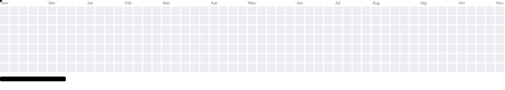

  

<b>每一次贡献，都点亮一格地图。</b> 写一点代码，存一个进度，下一关继续。

  <a href="https://github.com/ItsLoong?tab=repositories">代码存档 · 仓库</a>
  &nbsp; / &nbsp;
  <a href="https://github.com/ItsLoong?tab=stars">道具收藏 · Stars</a>
  &nbsp; / &nbsp;
  <a href="https://github.com/ItsLoong/ItsLoong/issues">留言板</a>

### 吃豆人 · 贡献地图

过去一年的贡献记录，变成吃豆人与幽灵追逐的街机地图。

<picture>
  <source media="(prefers-color-scheme: dark)" srcset="https://raw.githubusercontent.com/ItsLoong/ItsLoong/output/pacman-contribution-graph-dark.svg">
  <source media="(prefers-color-scheme: light)" srcset="https://raw.githubusercontent.com/ItsLoong/ItsLoong/output/pacman-contribution-graph.svg">
  
</picture>

<b>展开其他卡带 · 打砖块 / 太空射击</b>

#### 打砖块

把贡献格子变成砖块，看小球逐个击破。

<picture>
  <source media="(prefers-color-scheme: dark)" srcset="https://raw.githubusercontent.com/ItsLoong/ItsLoong/output/breakout-contribution-graph-dark.svg">
  <source media="(prefers-color-scheme: light)" srcset="https://raw.githubusercontent.com/ItsLoong/ItsLoong/output/breakout-contribution-graph.svg">
  
</picture>

#### 太空射击

看像素战机穿过这一年的贡献星图。

<picture>
  <source media="(prefers-color-scheme: dark)" srcset="https://raw.githubusercontent.com/ItsLoong/ItsLoong/output/galaga-contribution-graph-dark.svg">
  <source media="(prefers-color-scheme: light)" srcset="https://raw.githubusercontent.com/ItsLoong/ItsLoong/output/galaga-contribution-graph.svg">
  
</picture>

真实贡献 · 每日更新 · 自动播放的街机动画

感谢来访，下次读档见。

